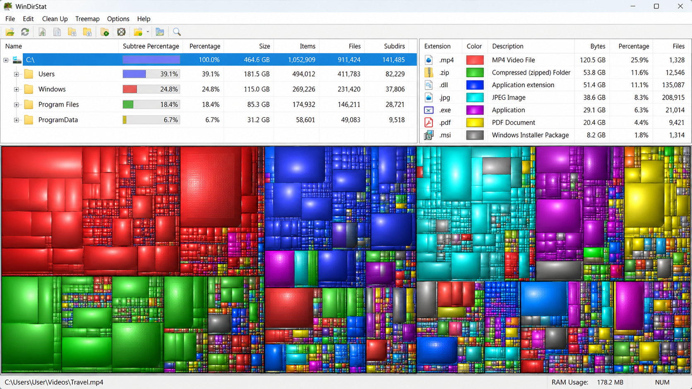
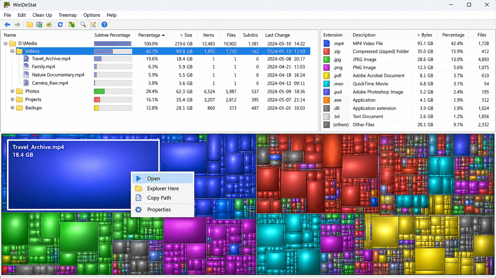
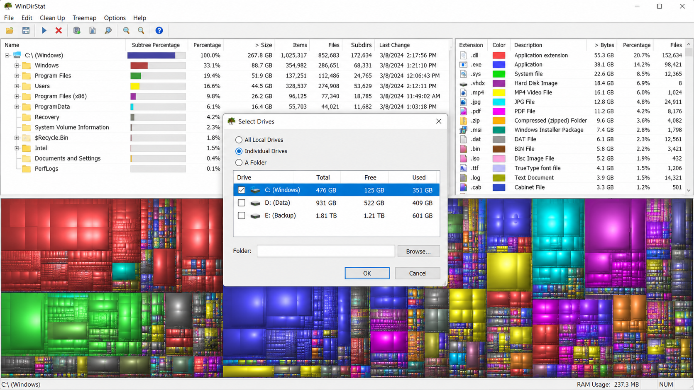

# WinDirStat Software - Windows Disk Space Analyzer

WinDirStat Software is a graphical disk-usage analyzer and cleanup assistant for Microsoft Windows. The WinDirStat Treemap organization maintains the WinDirStat Software repository, which combines directory statistics, file-type summaries, cleanup actions, and an interactive treemap.

## Description

WinDirStat Software scans drives, folders, network shares, and connected MTP devices. Results appear as a sortable directory list, an extension view, and a WinDirStat Treemap in which larger rectangles represent larger files.

The WinDirStat disk space analyzer helps identify where storage is being consumed without hiding the underlying directory hierarchy. Selecting an item in the WinDirStat Treemap locates it in the directory view, while selecting a file or folder highlights its visual block.

The retained C++ source includes basic, NTFS, and MTP finders, file metadata models, filtering, extension statistics, cleanup management, dark mode, and treemap rendering. WinDirStat Software is designed as a native WinDirStat for Windows application rather than a terminal-only analyzer.

### Major features

- Scan local drives, individual folders, network paths, and supported portable devices.
- Use accelerated NTFS scanning when suitable permissions are available.
- Sort files and directories by size, name, type, or other available metadata.
- Use WinDirStat find large files workflows through sorting, filtering, and visual inspection.
- Compare file extensions through the extension list and linked statistics view.
- Explore storage through the interactive WinDirStat Treemap.
- Select items in either the directory list or treemap and locate them in the other view.
- Configure WinDirStat cleanup actions for reviewed files and folders.
- Save directory information for later inspection.
- Use dark mode and configurable interface behavior.
- Review errors and diagnostic information through the retained logging components.

### What is WinDirStat used for?

WinDirStat is used to understand how files and folders consume storage on a Windows computer. WinDirStat Software scans a selected location, calculates directory totals, and connects those totals to a visual WinDirStat Treemap. This makes unusually large files, crowded directories, and file-type patterns easier to recognize.

The WinDirStat disk space analyzer is particularly useful before moving data, cleaning a nearly full drive, or investigating unexpected growth. WinDirStat Software can inspect a normal folder, a complete drive, a WinDirStat external drive, a supported portable device, or a WinDirStat scan network drive target. The results remain an analysis aid, so users should verify files before applying WinDirStat cleanup actions.

### Disk Space Language

windirstat software, windirstat for windows, windirstat disk space analyzer, windirstat treemap, windirstat cleanup, disk-usage, disk-space, storage-analyzer, directory-analyzer, file-visualization, treemap, windows, filesystem

### Getting started

1. Start WinDirStat Software and choose one or more drives or individual folders.
2. Allow the scan to finish, or begin exploring the results while the available views are updated.
3. Sort the directory list by size to identify the largest branches.
4. Select a large rectangle in the WinDirStat Treemap to locate its file in the directory hierarchy.
5. Review the extension list to see which file types account for the most disk-space usage.
6. Filter or inspect the results before opening any WinDirStat cleanup action.
7. Refresh the affected location after moving or deleting files.

### What can I delete using WinDirStat?

WinDirStat Software can help locate personal downloads, obsolete archives, old installers, temporary working data, large media files, and other content that you recognize and no longer need. It can also expose application caches, but a large cache is not automatically safe to remove. The WinDirStat Treemap reports size and location; it does not prove that a file is disposable.

Avoid deleting Windows system files, driver data, recovery files, unknown application directories, or anything whose purpose is unclear. Open questionable items in their containing folder, confirm that important data is backed up, and close applications that may be using them. WinDirStat cleanup should be treated as a reviewed action rather than an automatic recommendation.

## Installation

### Is it safe to download WinDirStat?

WinDirStat Software is safe when obtained from the official WinDirStat Treemap project distribution or another source explicitly recognized by the project. Unrelated websites may reuse the WinDirStat name, offer outdated builds, wrap the WinDirStat exe in another installer, or distribute modified files.

Check that the application name, publisher information, architecture, and release details match the expected WinDirStat Software package. Keep Windows security checks enabled and avoid installers that add unrelated programs. The repository includes packaging definitions such as [WinDirStat.wxs](WinDirStat.wxs), [WinDirStat.nuspec.template](WinDirStat.nuspec.template), and [Package.appxmanifest.template](Package.appxmanifest.template) for reviewing how supported packages are described.

## Copyright / Licenses

WinDirStat Software is distributed under the terms recorded in [LICENSE](LICENSE). Components or bundled material with separate terms are documented in [THIRD_PARTY_LICENSES.txt](THIRD_PARTY_LICENSES.txt).

The WinDirStat Treemap organization retains contributor history in [CONTRIBUTORS.md](CONTRIBUTORS.md). Contributors should also review [CODE_OF_CONDUCT.md](CODE_OF_CONDUCT.md) before participating.

## Compatibility

WinDirStat Software targets Microsoft Windows and is represented by native C++ source and Visual Studio project files. The supported family described by the source material includes:

- Windows 7
- Windows 8 and Windows 8.1
- WinDirStat Windows 10
- WinDirStat Windows 11
- Windows Server 2008 R2 through Windows Server 2025

WinDirStat portable operation can be useful when the program must run without a conventional installation. Compatibility can still depend on the selected build architecture, Windows configuration, device type, permissions, and filesystem.

### Is there anything better than WinDirStat?

There is no single disk analyzer that is better for every workflow. Terminal analyzers may be preferable for remote administration or scripted reports, Unix-oriented graphical analyzers may integrate better with Linux desktops, and duplicate-focused suites may offer broader content comparison features.

WinDirStat Software is a strong choice when the goal is native Windows directory analysis with a synchronized directory tree, extension summary, and WinDirStat Treemap. The WinDirStat Treemap organization focuses on a visual Windows workflow rather than replacing every specialized storage utility. Users who need WinDirStat Linux or WinDirStat Android should understand that those platforms require a different implementation, while WinDirStat Software remains centered on Windows.

## Resources

- Read recent project changes in [CHANGELOG.md](CHANGELOG.md).
- Review common questions in [FAQ.md](FAQ.md).
- Diagnose known problems with [Troubleshooting.md](Troubleshooting.md).
- Read build requirements in [Building.md](Building.md).
- Review project contributors in [CONTRIBUTORS.md](CONTRIBUTORS.md).
- Inspect the WinDirStat Software solution in [windirstat.sln](windirstat.sln).

The WinDirStat Reddit community and other user discussions can provide practical examples, but project documentation and retained source files should remain the primary technical reference.

## Official Downloads and Malware Warning

WinDirStat Software is widely recognized, which makes its name attractive to unofficial download sites. Some sites may present themselves as an official WinDirStat Software source even though they are not controlled by the WinDirStat Treemap organization.

Use only project-recognized distribution channels. Do not disable security software merely because an unknown installer requests it, and do not trust a package solely because its filename contains WinDirStat exe or WinDirStat portable. When asking “is WinDirStat safe,” the source and integrity of the specific package matter as much as the application name.

## Building

WinDirStat Software can be built with Visual Studio 2022 or later. Open [windirstat.sln](windirstat.sln), select the required architecture and configuration, and build the solution.

The primary project definition is [windirstat.vcxproj](windirstat.vcxproj), with IDE organization stored in [windirstat.vcxproj.filters](windirstat.vcxproj.filters). Shared settings are defined in [Project.props](Project.props), while [GitRevision.targets](GitRevision.targets) provides revision-related build integration.

### Build Environment

A suitable build environment includes:

- Visual Studio with the Desktop Development with C++ workload.
- A Windows SDK compatible with the selected target.
- The C++ language and runtime components required by the project.
- Packaging components when building installer or application packages.

### Source overview

| Area | Retained files | Purpose |
| --- | --- | --- |
| Application | [src/WinDirStat.cpp](src/WinDirStat.cpp), [src/WinDirStat.h](src/WinDirStat.h) | Initializes WinDirStat Software and its application-level behavior. |
| Main window | [src/MainFrame.cpp](src/MainFrame.cpp), [src/MainFrame.Commands.cpp](src/MainFrame.Commands.cpp) | Coordinates commands, views, and the main WinDirStat for Windows interface. |
| Scanning | [src/FinderBasic.cpp](src/FinderBasic.cpp), [src/FinderNtfs.cpp](src/FinderNtfs.cpp), [src/FinderMtp.cpp](src/FinderMtp.cpp) | Provides general, NTFS, and MTP discovery paths. |
| Directory model | [src/DirInfo.cpp](src/DirInfo.cpp), [src/DirReadJob.cpp](src/DirReadJob.cpp), [src/FileInfo.cpp](src/FileInfo.cpp) | Represents directories, scan jobs, and file metadata. |
| Treemap | [src/TreeMap.cpp](src/TreeMap.cpp), [src/TreeMapView.cpp](src/TreeMapView.cpp) | Calculates and renders the WinDirStat Treemap. |
| Extensions | [src/ExtensionListControl.cpp](src/ExtensionListControl.cpp), [src/ExtensionView.cpp](src/ExtensionView.cpp) | Summarizes storage by file extension. |
| Cleanup | [src/Cleanup.cpp](src/Cleanup.cpp), [src/CleanupCollection.cpp](src/CleanupCollection.cpp) | Defines and organizes WinDirStat cleanup actions. |
| Interface | [src/DarkMode.cpp](src/DarkMode.cpp), [src/ConfigDialog.cpp](src/ConfigDialog.cpp), [src/ColorButton.cpp](src/ColorButton.cpp) | Supports appearance and configuration behavior. |

### Compiling

1. Open [windirstat.sln](windirstat.sln).
2. Restore or configure any required Visual Studio components.
3. Choose the intended platform and build configuration.
4. Build the WinDirStat Software solution.
5. Review compiler output and resolve configuration-specific warnings or errors.
6. Validate scanning, selection, extension statistics, WinDirStat Treemap rendering, and cleanup prompts before distributing a build.

For packaging details, inspect [WinDirStat.wxs](WinDirStat.wxs), [Defines.wxi](Defines.wxi), [windirstat.manifest](windirstat.manifest), and [version.rc](version.rc).

## Contributors

Contributions to WinDirStat Software may include C++ fixes, Windows compatibility improvements, translations, documentation, packaging, and testing across supported filesystems and devices. Changes should remain focused on the WinDirStat Treemap organization’s Windows storage-analysis workflow.

Before contributing, read [Building.md](Building.md), [CODE_OF_CONDUCT.md](CODE_OF_CONDUCT.md), and [CONTRIBUTORS.md](CONTRIBUTORS.md). Test changes against realistic directory trees, restricted paths, large files, network locations, and removable storage where applicable.

## Logo

